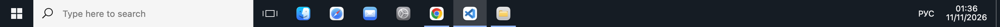
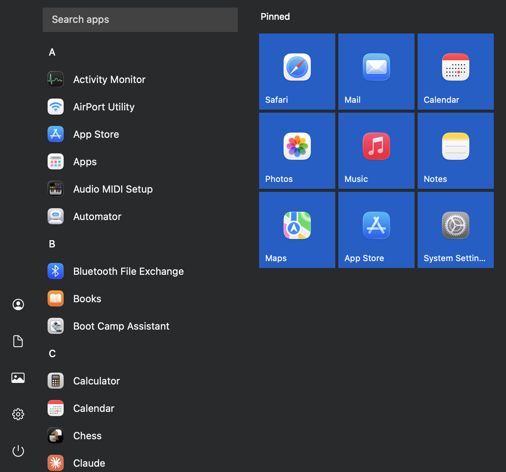
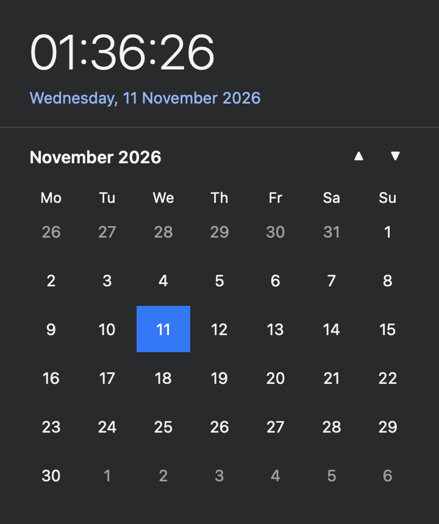
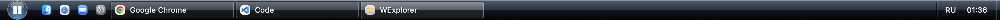
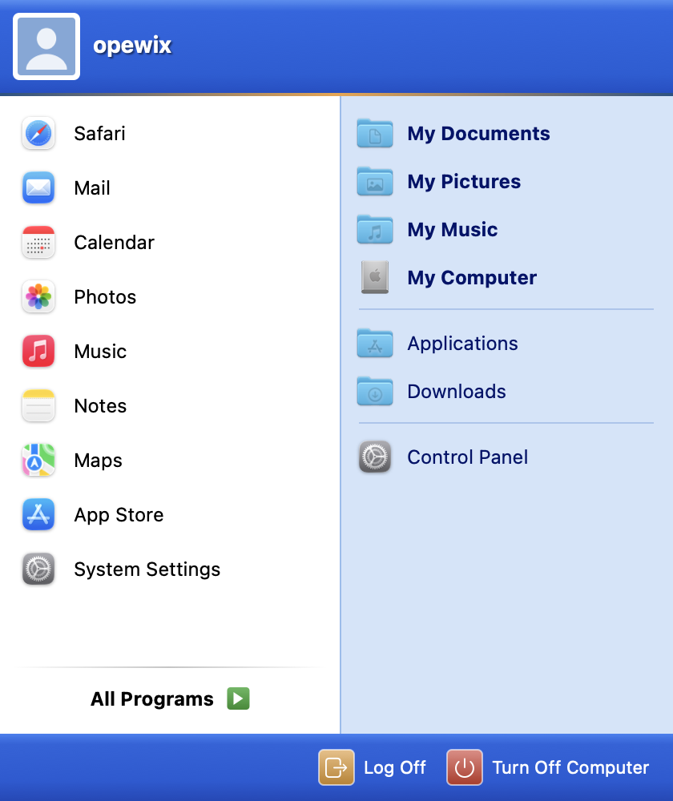
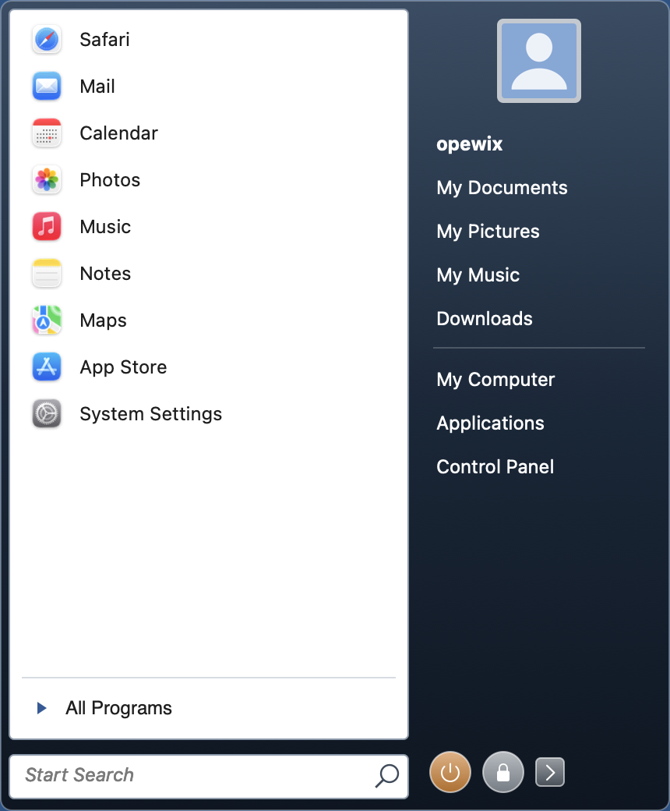
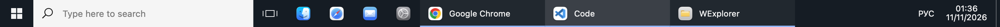
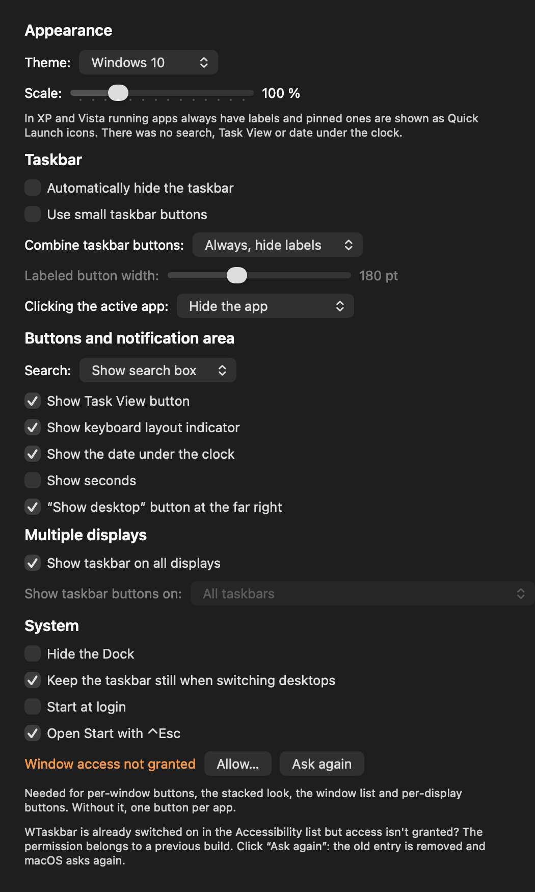

# WTaskbar

A Windows-style taskbar for macOS that replaces the Dock, in Windows 10, Windows Vista and
Windows XP themes: Start menu, taskbar buttons you can drag around, window grouping, keyboard
layout indicator, clock with a calendar flyout and the “show desktop” strip.



 

## Features

- **Taskbar buttons:** pinned and running apps; click to launch, bring to front, or hide the active
  app (like minimizing in Windows). Underline for running apps, highlight for the active one,
  “stacked” look when an app has several windows.
- **Drag to reorder:** hold a button and move it left or right, like in Windows; works for pinned
  apps that aren't running and for window buttons. The order of pinned apps is remembered.
- **Jump list (right-click):** the app's windows, pin / unpin, show in Finder, hide, close.
- **Start menu** (click or ⌃Esc): alphabetical list of installed apps, type to search, Enter to
  launch, pinned tiles, Documents / Pictures / Settings, lock, sign out, sleep, restart, shut down.
- **Notification area:** keyboard layout (ENG / РУС, click to switch), clock and date, calendar flyout.
- **Show desktop** strip at the right edge, **Task View** button opens Mission Control.
- **Stays still when switching desktops**, like the Dock (uses a private macOS API; can be
  turned off in settings).
- **Hides the Dock** the same way uBar does (autohide with a very long delay) and restores it on quit.
- English and Russian, following the system language.

## Themes

Pick a theme in **Taskbar settings → Appearance**. Each theme has its own taskbar, Start menu and
calendar: Windows 10 (dark), Windows Vista (black glass, round Start button, “Start Search”) and
Windows XP (blue Luna, green Start button, two-column Start menu with “All Programs”).




 

## Settings

Right-click the taskbar → **Taskbar settings…**, modeled after the Windows 10 page:

- theme and scale (70–200 % in 10 % steps, remembered per theme — XP and Vista are smaller by design);
- automatically hide the taskbar, small taskbar buttons;
- combine taskbar buttons: *always, hide labels* / *when taskbar is full* / *never* — without
  combining, every window gets its own labeled button; labeled button width;
- what clicking the active app does: hide the app / minimize the window / nothing;
- search: hidden / icon / box; Task View button, keyboard layout indicator, date, seconds,
  “show desktop” strip;
- multiple displays: taskbar on all displays, buttons on all taskbars / main taskbar and the one
  where the window is open / only where the window is open;
- hide the Dock, start at login, ⌃Esc for Start.





## Install

1. Download `wtaskbar-<version>.dmg` from [Releases](https://github.com/opewix/wtaskbar/releases).
2. Open it and drag **WTaskbar** to **Applications**.
3. The app is not notarized by Apple, so macOS blocks the first launch. Open it once, then go to
   **System Settings → Privacy & Security** and click **Open Anyway**. Or run:

   ```sh
   xattr -dr com.apple.quarantine /Applications/WTaskbar.app
   ```

On first launch WTaskbar asks whether to hide the Dock. Right-click the taskbar for its menu and
**Taskbar settings…**; to quit, choose **Quit WTaskbar** there — the Dock comes back.

Requires macOS 13 Ventura or later.

## Permissions

- **Accessibility** (optional) — for per-window buttons, the window list, raising a specific
  window, the stacked look and per-display buttons. Taskbar settings → **Allow…**.
  If WTaskbar is switched on in the list but access still isn't granted, the permission belongs to
  an older build: click **Ask again** in Taskbar settings. Builds from 0.7 on keep the permission
  across updates (they are signed with a requirement on the bundle identifier, not the build hash).
- **Automation → loginwindow** — asked the first time you use restart / shut down / sign out.

## Build from source

Only the Swift toolchain is needed (Xcode Command Line Tools), no Xcode project.

```sh
swift build                                   # debug build
./scripts/bundle.sh                           # build/WTaskbar.app
VERSION=0.7 ./scripts/make-dmg.sh             # build/wtaskbar-0.7.dmg
.build/debug/WTaskbar -snapshot reference     # re-render the screenshots above (add -theme xp|vista)
```

If the app crashes while the Dock is hidden, bring the Dock back with:

```sh
defaults write com.apple.dock autohide -bool false; defaults delete com.apple.dock autohide-delay; killall Dock
```

## License

[MIT](LICENSE). Free to use, modify and distribute; provided as is, without any warranty.

## Disclaimer

WTaskbar is an independent project, not affiliated with or endorsed by Microsoft. Windows is a
trademark of Microsoft Corporation. The app ships no Microsoft code, icons or fonts: all graphics
are drawn by the app itself; app icons come from macOS.
